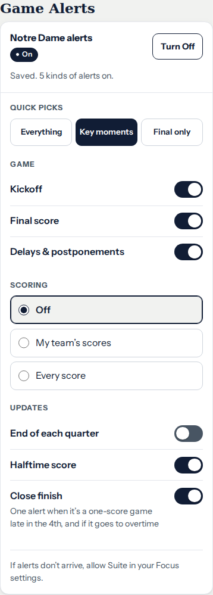
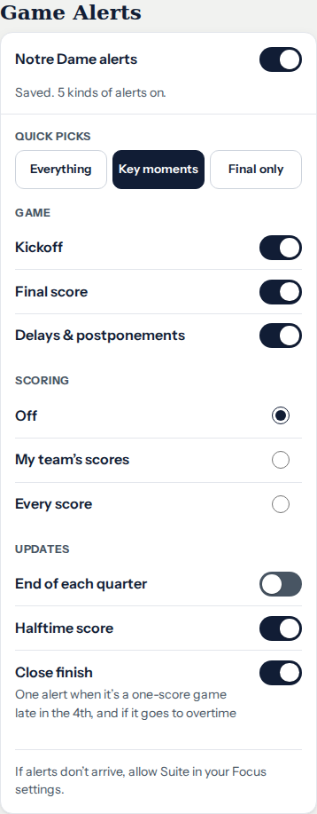
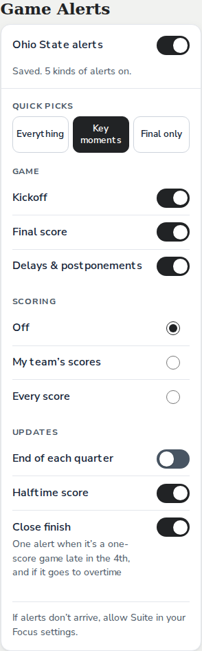

# Game Alerts Settings — revised October 13

Review candidate: draft PR #137 (`codex/alerts-settings-oct13`). David asked
for a master toggle and more consistent layout and UI properties after
reviewing the first pass. This revision is not merged or deployed.
Environment setup remains paused in #135/#136 and Claude handoff #133.

## Revision

- The master uses the same native checkbox switch, track, thumb, colors and
  focus ring as the individual alert options. Its team label and helper text
  identify what it controls. The separate status pill and Turn On/Off button
  are removed.
- Master, option and scoring rows share label type, row padding, separators,
  and a right-aligned control column. Scoring remains one native radio choice;
  its three separate bordered boxes are removed.
- Quick picks remain shortcut buttons, with a single shared size/radius,
  selected fill and group label. All four groups use the same fieldset/legend
  treatment. Helper text uses one size and line height; group gaps are tighter.

The master requests permission only on explicit activation, including Space
on the keyboard. It keeps the confirmed subscription state while work is
pending, restores that state after repeated pending taps, and reports a failed
change without falsely showing a successful toggle. Existing defaults,
quick-pick membership, save/unsubscribe sequencing and backend routes remain.
The recovery hint now refers to switching alerts off/on. New alert types,
service deduplication and notification-delivery changes remain Claude's work.

## Actual browser captures

Local production renderer/CSS with stubbed push responses: no real fan push.
Shipping fonts loaded, including Nunito Sans for Ohio State Team Style;
external team marks use the existing fallback. Both Notre Dame captures use
Key moments, so the comparison isolates presentation.

| Previous review, 390px | Revised controls, 390px |
|---|---|
|  |  |

## Verification

- Existing Suite renderer checks pass for on/off/busy/unsupported/install and
  denied states. The master has an explicit accessible name/description.
- The alert browser suite passes its existing defaults, quick picks, custom
  choices, legacy settings and in-flight-save/unsubscribe cases. New checks
  cover keyboard activation, focus, no permission request on initial render,
  repeated pending taps, failed unsubscribe/retry and denied permission.
- Focus restoration, controller, boot and service-worker checks pass. The
  service-worker version is `suite-2026-10-13alerts2`.
- ND/OSU × Team/Suite styles × 320/390/1280px: 12 rendered combinations fit.
  Row and quick-pick hit areas are at least 44px. At 320px, 200% text sizing
  reflows without page overflow or clipped labels. Off, pending, denied,
  install-first, unsupported and error states are included in the captures.
- The existing pixel auditor passed its self-test, then checked 46 text
  elements and 14 focus stops per team/style at 320px, with no failures or
  unverified focus rings. One existing text region per page was unassessed.
- CSS: 848 rules, zero dead or shadowed rules. JS syntax and whitespace pass;
  the committed shell version advances from both main and the prior UI revision.
- [Machine-readable review](alerts-2026-10-13/verification.json).

Full CI must pass on the revised PR head. David's visual approval and physical
Safari/iPhone/PWA observation are separate from these desktop checks. The
prior revision's results do not constitute approval of this revision.
