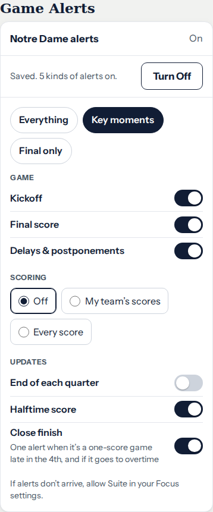

# Game Alerts Settings presentation review — October 13

Resumes the unpublished October 12 UI refinement on main `011eab3`.
Review candidate: PR #137 (`codex/alerts-settings-oct13`); not merged or
production-verified. Environment work remains paused in #135/#136 and the
Claude handoff #133.

## What changed

The team, On/Off status and explicit action now share a compact overview.
Quick picks have a visible heading and equal-width controls. Scoring keeps
one native radio choice with full-width rows instead of wrapping chips.
Group spacing and the Focus hint are clearer, and off switches have a visible
track. Long alert labels can reflow at 200% text sizing.

Defaults, quick-pick membership, alert copy, permission requests, save/turn-off
sequencing and subscription endpoints are unchanged. Kickoff-time alerts and
both-teams deduplication remain Claude's service work. The service-worker
version is `suite-2026-10-13alerts1` so installed clients receive the new shell.
The existing Suite unit assertion now locates the sole semantic Turn On
button without demanding an exact CSS-class string.

## Review captures

These are the actual production renderer and CSS in a local browser with
stubbed permission/subscription responses. No notification was sent to a fan.
The before and after Notre Dame captures show the same Key moments selection.
The team mark's normal fallback is used because external images are blocked;
shipping local typefaces loaded, including Nunito Sans for Ohio State Team Style.

| Before — Notre Dame, Suite Style, 390px | After — same state |
|---|---|
|  |  |

## Verification

- `node tools/suitecheck.js`: renderer contracts pass, including supported,
  off, on, busy, denied and install-first controls.
- `node tools/alertscheck.js`: defaults, quick picks, custom choices, focus,
  legacy preferences and in-flight-save/turn-off sequencing pass with a stubbed API.
- `node tools/moreflowcheck.js`: Settings refresh/recovery and connection
  behavior pass with recorded provider fixtures.
- Rendered review: ND and OSU × Team and Suite styles × 320/390/1280px
  (12 combinations). No page overflow; option rows, scoring labels, quick
  picks and the explicit toggle have at least 44px height. At 320px,
  200% text sizing preserves reflow and label content. Off, busy, denied,
  install, unsupported and error states also fit at 320px.
- The existing pixel auditor passed its self-test, then checked 48 text
  elements and 14 keyboard-focus stops per team/style at 320px: no failures
  or unverified focus rings. One existing text region per page was unassessed;
  this is not a claim that every pixel was machine-verified.
- `python3 tools/csscheck.py app.css`: 857 rules, zero dead or shadowed rules.
  JS syntax, whitespace and committed `versioncheck origin/main` pass.
- Machine-readable local review: [verification.json](alerts-2026-10-13/verification.json).

Full GitHub CI is running on PR #137. David's visual approval and physical
Safari/iPhone/PWA observation remain separate from desktop checks. The PR
has not been merged or deployed.
