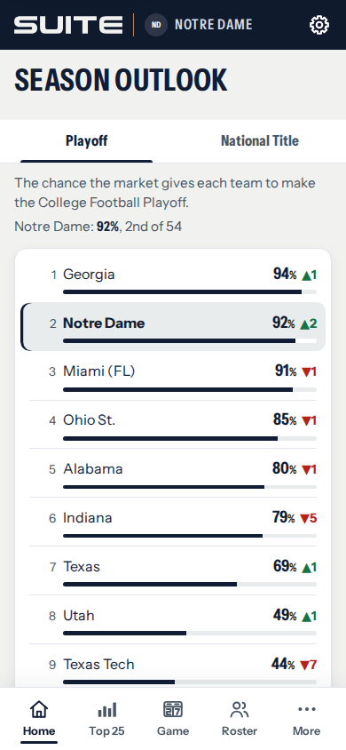
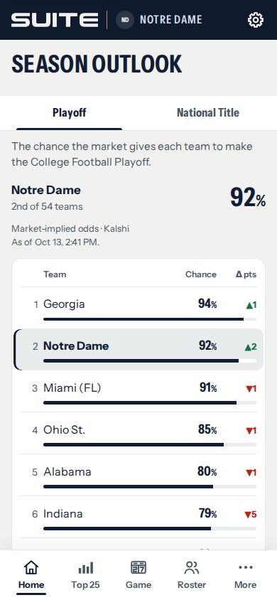
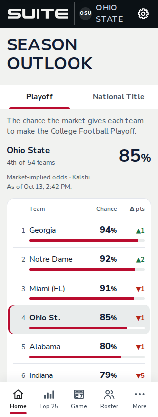
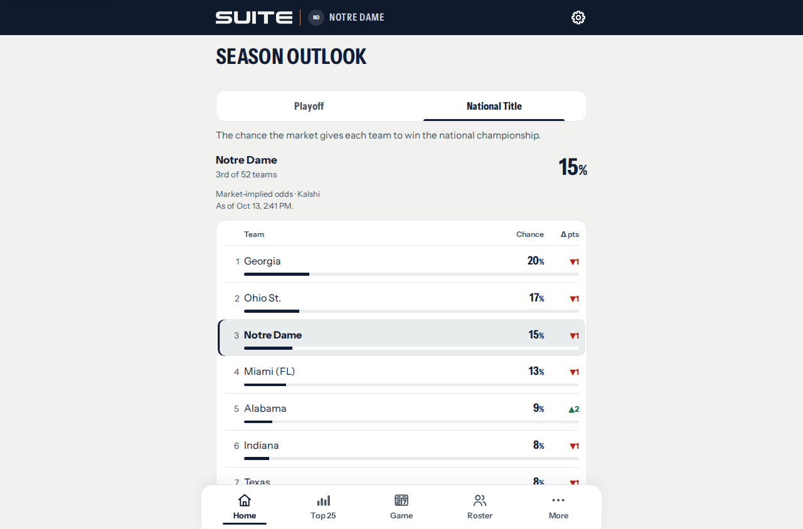

# Season Outlook UI review — October 13

David authorized an Outlook consistency pass after the Game Alerts revision.
This is a review candidate on `codex/outlook-ui-oct13`, based on main
`fff625e`. It is not merged or deployed. Environment setup stays paused in
#135/#136 and Claude handoff #133; Game Alerts remains its own candidate #137.

## What changed

- Each probability has a fixed column; the presence or width of a change
  figure no longer moves it. A quiet header identifies team, chance and
  percentage-point change. Missing or negligible movement remains blank.
- The existing team summary now separates the team name, position in the
  field and chance. The corresponding row retains its highlight.
- Kalshi attribution and the actual snapshot timestamp appear above the
  field. Saved prices still say so. The information-only note and explanation
  of percentage points remain below the list.
- Row spacing and card treatment follow the other statistical lists.
  At enlarged text sizes, numbers move beneath the team name.

The complete field, ordering, rounded values, under-1% labels, market
selection, Home ownership, data loading and recovery behavior are preserved.
No market logic, controller, source, API or notification changes are included.
The shell version is `suite-2026-10-13outlook1`.

## Browser comparison

Actual application and bundled fonts, using committed snapshots with external
requests blocked. Header marks use the existing initials fallback. These are
local browser captures, not evidence of a hosted deployment or physical iPhone.

| Previous, Suite Style at 390px | Revised, Suite Style at 390px |
|---|---|
|  |  |

## Verification

- `tools/outlookcheck.js` passes: full-field values/order, team highlight and
  Home agreement, both tabs, Back navigation, failed refresh, offline and
  reconnection. Its new layout checks cover both teams/styles at 320, 390
  and 1280px, plus 200% text at 320px: aligned chances, unclipped Outlook
  names/numbers, no page overflow, and source above the list.
- The review capture matrix covers ND/OSU × Team/Suite × both markets ×
  320/390/1280px, plus loading, failure, offline, empty, uncovered, unpriced
  and saved states. The capture's pixel audit checks text and keyboard focus
  at 320px after passing its self-test; detailed counts and any unassessed
  regions are in [verification.json](outlook-2026-10-13/verification.json).
- Suite renderer, controller, boot and service-worker checks pass. JavaScript
  parses; whitespace checks pass. CSS has 863 rules, zero dead or shadowed.
- Full PR CI and David's visual/release approval are separate gates. Enlarged
  text checks apply to the Outlook content; existing global header/navigation
  behavior is not redesigned by this pass. Physical Safari/PWA review remains
  separate from desktop Chromium checks.

## Integration

This branch and #137 both advance `sw.js`; retain a new version when combining
them. Their CSS edits are in separate screen sections. Preserve Claude's
normalized market inputs and use this presentation when integrating future
season states. DEV/Lab work is not a prerequisite for reviewing these screens.
